<div align="center">

# 🛡️ Cybersecurity Lab Setup — VirtualBox + Kali Linux

### Networkwalks Cybersecurity Internship · Batch B084 · Week 1 · Project Module 1 (WK1-PM1)


**Author:** Junaideen Risny Suha · Cybersecurity Intern (Intern ID: NW-084-0NS)
<br>Higher Diploma in IT — ICST, Sri Lanka

</div>

---

## 📌 Objective

Build an **isolated, repeatable cybersecurity testing lab** on a personal laptop, with Kali Linux as the attacker machine on a dedicated virtual subnet. This lab is the base for every later module of the program (vulnerability assessment, penetration testing, SOC, forensics).

## ✅ Task Requirements — Completion Matrix

| # | Requirement (from WK1-PM1 brief) | Status | Evidence |
|---|---|:---:|---|
| 1 | Use **VirtualBox** as the base (latest recommended version) | ✅ | [01](#1-virtualbox-host-platform) |
| 2 | Set up **Kali Linux** as the attacking / hacker machine | ✅ | [03](#3-kali-linux-vm-imported), [07](#7-kali-desktop-up-and-running) |
| 3 | Set up the network in subnet **10.0.0.0/24** | ✅ | [02](#2-nat-network--100000024) |
| 4 | Use **NATNetwork** with 10.0.0.0/24 | ✅ | [02](#2-nat-network--100000024), [05](#5-network-adapter--attached-to-natnetwork) |
| 5 | **Clipboard & file drag/drop** enabled in the VM | ✅ | [04](#4-shared-clipboard--drag-and-drop) |
| 6 | **Shared folder** enabled with `/downloads` | ✅ | [06](#6-shared-folder--downloads), [09](#9-full-lab-verification) |
| 7 | Kali IP address **10.0.0.2/24** | ✅ | [08](#8-static-ip-100022-and-internet-test), [09](#9-full-lab-verification) |
| 8 | Kali has **full Internet access** | ✅ | [08](#8-static-ip-100022-and-internet-test), [09](#9-full-lab-verification) |
| 9 | Take a **snapshot** of the VM | ✅ | [10](#10-snapshot--wk1-lab-ready) |

---

## 🗺️ Lab Architecture

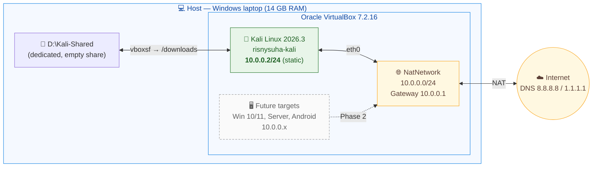

## 🧰 Lab Environment

| Component | Configuration |
|---|---|
| Host OS | Windows (untouched — Kali runs only inside a VM, no dual boot) |
| Hypervisor | Oracle VirtualBox **7.2.16** (r174877) |
| Guest OS | Kali Linux **2026.3** — official pre-built VirtualBox image (Kali Rolling, x64) |
| VM resources | 4 GB RAM · 2 vCPU · 80 GB dynamic disk (stored on D:, not the system drive) |
| Network | Adapter 1 → **NAT Network** `NatNetwork` · Promiscuous mode: **Allow All** |
| Kali addressing | `10.0.0.2/24` · GW `10.0.0.1` · DNS `8.8.8.8`, `1.1.1.1` (static, via NetworkManager) |
| Hostname | `risnysuha-kali` |
| Integration | Shared clipboard: Bidirectional · Drag-and-drop: Bidirectional |
| Shared folder | Host `D:\Kali-Shared` → Guest `/downloads` (auto-mount, read/write) |
| Snapshot | `WK1 Lab Ready` |

---

## 🔧 Implementation — Step by Step

### Phase 1

**Step 1–2 · VirtualBox.** Verified VirtualBox 7.2.16 (current 7.2 branch) was installed on the host.

**Step 3 · NAT Network.** `File → Tools → Network Manager → NAT Networks → Create`, then set the IPv4 prefix to `10.0.0.0/24` and applied.

**Step 4 · Kali VM.** Downloaded the official image `kali-linux-2026.3-virtualbox-amd64.7z` from [kali.org/get-kali](https://www.kali.org/get-kali/#kali-virtual-machines), extracted it to `D:\VirtualBox VMs\` and registered it with `Machine → Add`. Then configured:
- **System:** base memory raised from 2 GB to 4 GB for a smoother attacker box
- **General → Features:** Shared Clipboard and Drag-and-Drop set to *Bidirectional*
- **Network → Adapter 1:** *NAT Network* → `NatNetwork`, Promiscuous Mode *Allow All* (ready for Wireshark / sniffing modules)
- **Shared Folders:** `D:\Kali-Shared` → mount point `/downloads`, auto-mount ✔

**Step 5 · Static IP on Kali** (NetworkManager CLI):

```bash
# Static IPv4 10.0.0.2/24 on the NAT Network (dad-timeout 0 avoids the known VBox 7 / Kali 2026 no-internet issue)
sudo nmcli con mod "Wired connection 1" ipv4.method manual \
     ipv4.addresses 10.0.0.2/24 ipv4.gateway 10.0.0.1 \
     ipv4.dns "8.8.8.8 1.1.1.1" ipv4.dad-timeout 0

# Re-apply the connection
sudo nmcli con down "Wired connection 1"; sudo nmcli con up "Wired connection 1"

# Personalised hostname for clear evidence
sudo hostnamectl set-hostname risnysuha-kali
echo "127.0.1.1 risnysuha-kali" | sudo tee -a /etc/hosts
```

**Verification:**

```bash
whoami; hostname
ip -4 -br addr show eth0          # → eth0 UP 10.0.0.2/24
ip route | head -1                # → default via 10.0.0.1 dev eth0 proto static
grep nameserver /etc/resolv.conf  # → 8.8.8.8, 1.1.1.1
ls -ld /downloads                 # → root vboxsf … /downloads
ping -c 3 google.com              # → 0% packet loss
```

**Step 6 · Snapshot.** `Machine → Take Snapshot` → **`WK1 Lab Ready`**, a clean restore point before any offensive practice.

### Phase 2 (optional — upcoming)
Add Windows 11/10/7, Windows Server and Android VMs on the same `NatNetwork` (10.0.0.x), ping-test every machine from Kali and snapshot each.

---

## 📸 Evidence

#### 1. VirtualBox host platform
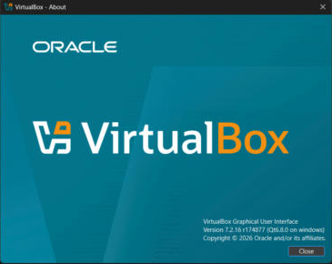

#### 2. NAT Network — 10.0.0.0/24
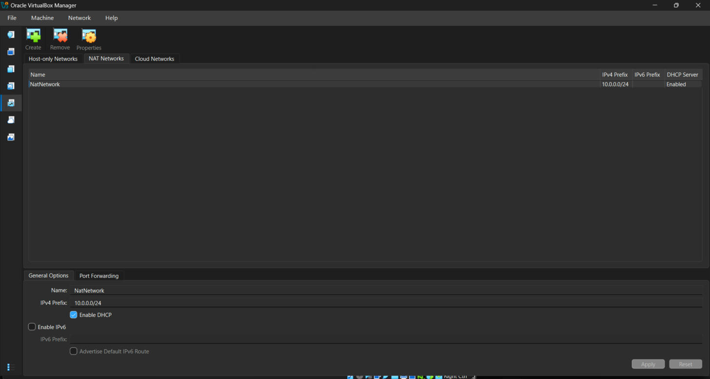

#### 3. Kali Linux VM imported
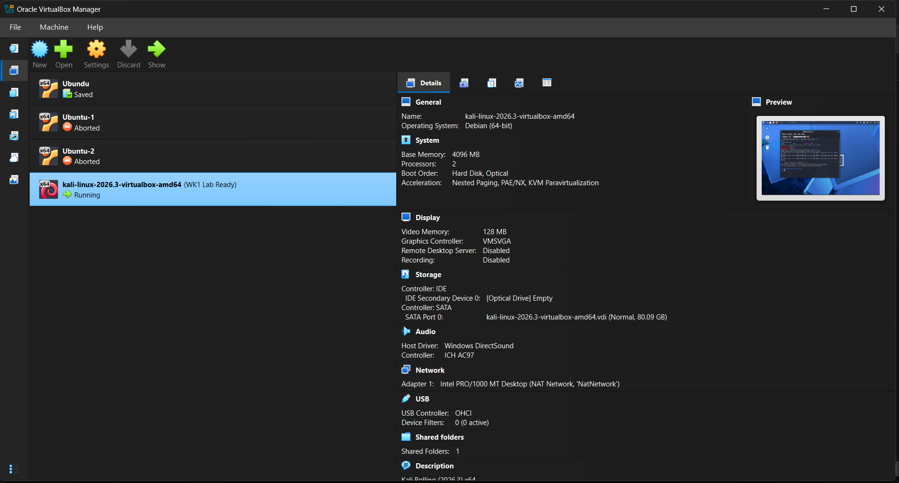

#### 4. Shared clipboard & drag-and-drop
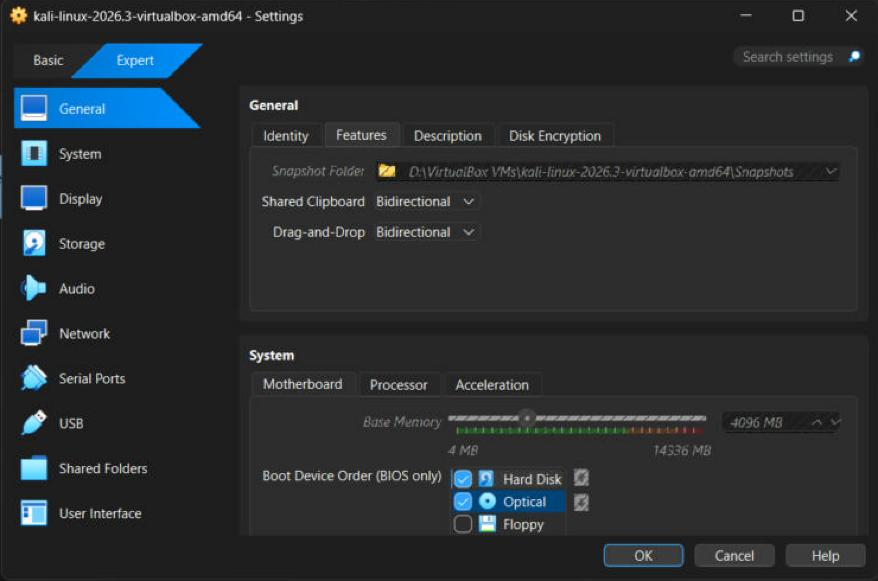

#### 5. Network adapter — attached to NatNetwork
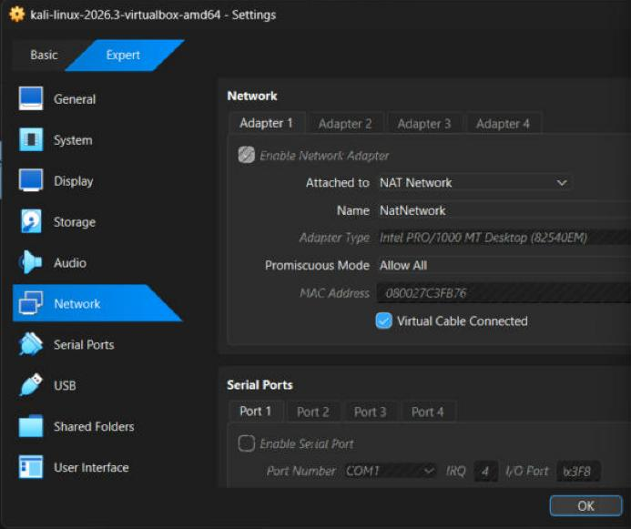

#### 6. Shared folder → /downloads
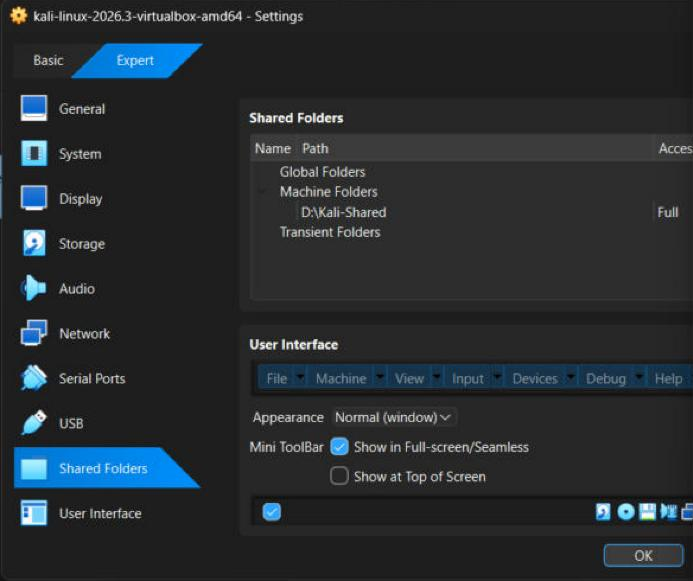

#### 7. Kali desktop up and running
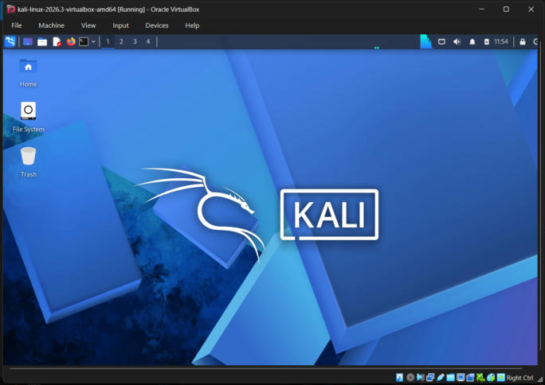

#### 8. Static IP 10.0.0.2 and Internet test
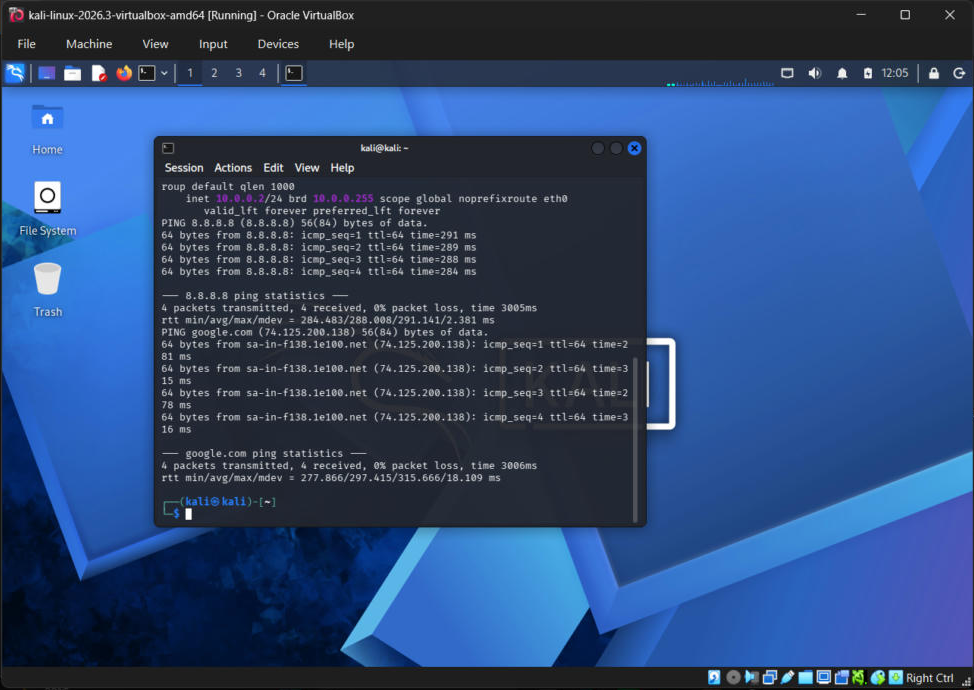

#### 9. Full lab verification
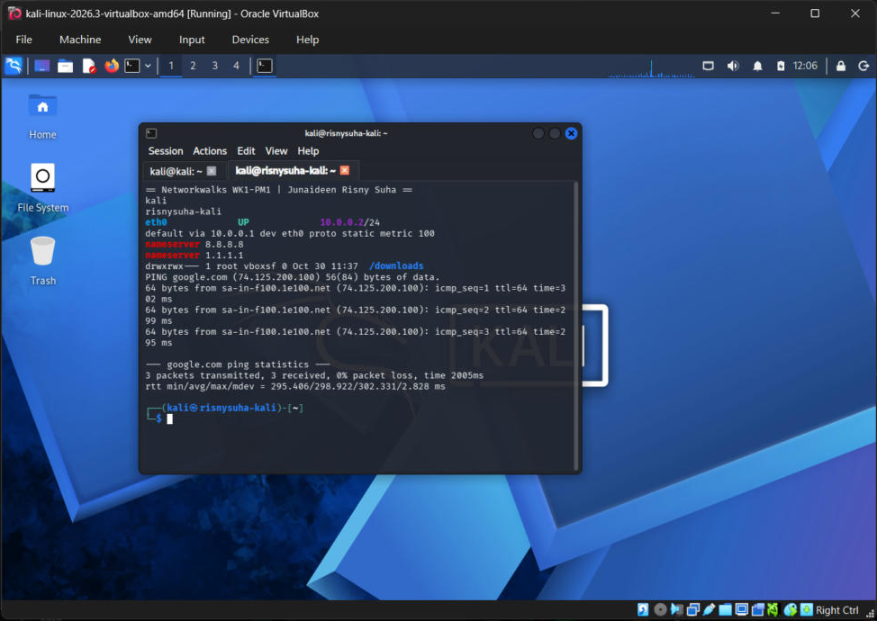

#### 10. Snapshot — WK1 Lab Ready
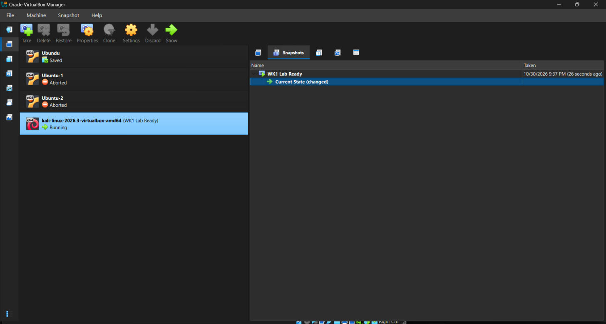

---

## 🧯 Troubleshooting Log (problems I hit & how I solved them)

| # | Problem | Root cause | Fix |
|---|---|---|---|
| 1 | VirtualBox refused to save settings: *"Shared folder path `D:\\Kali-Shared` is not absolute"* | The path box auto-completes `D:` → `D:\`, so typing another `\` produced a double backslash | Removed the share and re-added it with the **Folder Path → Other…** folder picker, so VirtualBox builds the path itself |
| 2 | Keyboard stopped responding inside the Kali terminal (stray characters, then no input) | Keyboard state stuck in the guest after an automated paste | `Machine → Reset` on the fresh VM; afterwards entered commands with **Ctrl + Shift + V** (terminal paste) via the bidirectional clipboard |
| 3 | Login failed: *"Your password is incorrect"* | Username typed as `Kali` — Linux usernames are case-sensitive | Logged in with lowercase `kali` |
| 4 | *(Prevention)* Known "no internet" issue on VirtualBox 7 + Kali 2026.x | IPv4 duplicate-address-detection delay on NAT Network | Added `ipv4.dad-timeout 0` to the static IP profile up front — internet worked on the first try |

## 🔐 Security & Ethics Notes
- The lab is **isolated** on its own NAT subnet; all testing stays inside VMs I own.
- The shared folder is a **dedicated empty folder** (`D:\Kali-Shared`), not my real Downloads, so the attacker VM can't read personal files.
- Default `kali/kali` credentials are a known weakness. **Change them with `passwd`** before any lab exercise.
- The snapshot gives a clean rollback point after risky experiments or malware analysis.

## 💡 Key Learnings
- How NAT Network differs from plain NAT: VMs on it can talk to **each other** *and* reach the internet, which is what a pentest lab needs.
- Static addressing with `nmcli`, and why predictable IPs matter when scanning and attacking targets.
- VirtualBox Guest Additions integration (clipboard, drag-and-drop, `vboxsf` shared folders).
- Snapshots as a safety net before risky work.

---

<div align="center">

**Networkwalks Cybersecurity Program** · Instructor: Waqas Karim (CCIE)
<br>Built with ❤️ by **Junaideen Risny Suha** · [GitHub @DevRisny](https://github.com/DevRisny) · [LinkedIn](https://www.linkedin.com/in/risny-suha-8a6b66423)

#Networkwalks #Cybersecurity #KaliLinux #VirtualBox

</div>
